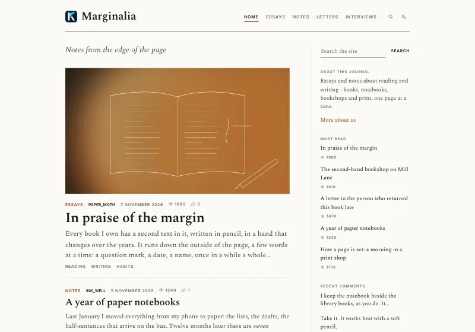
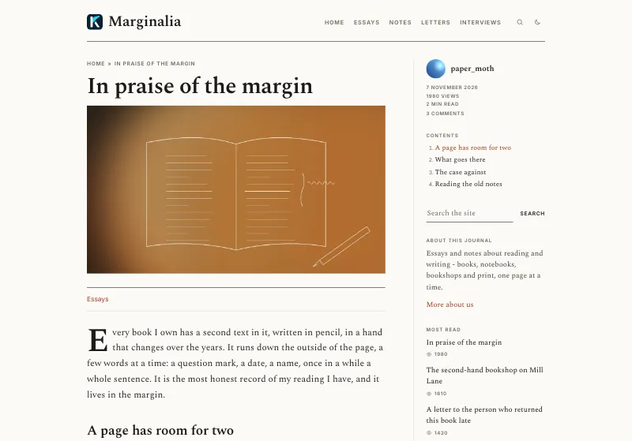
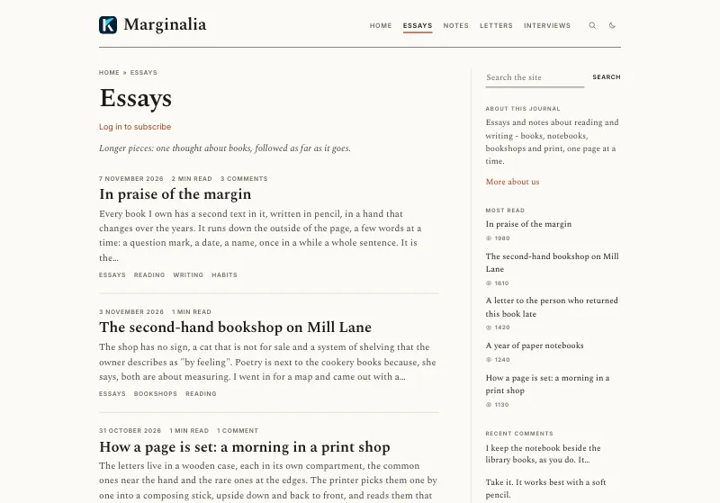
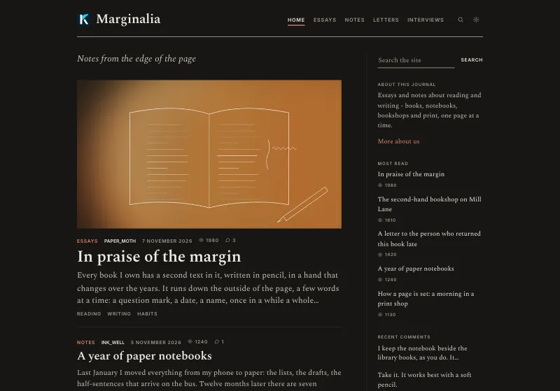
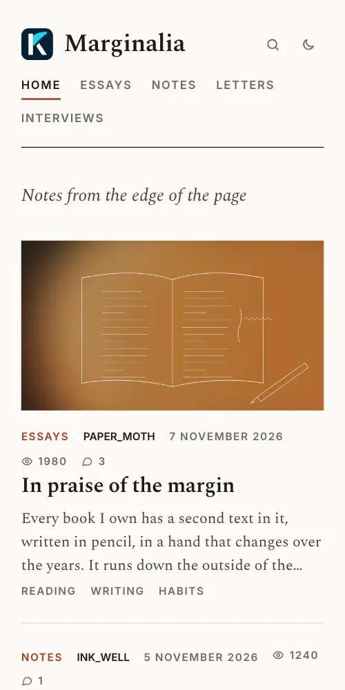
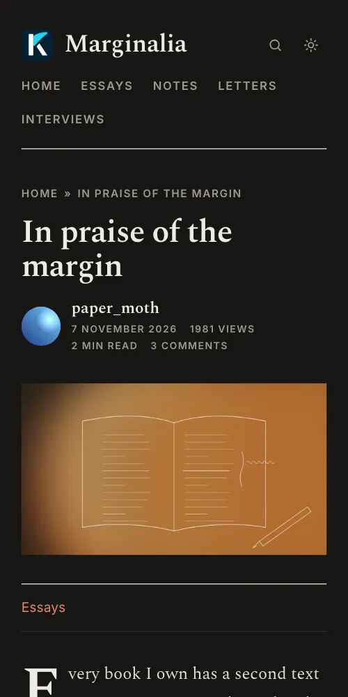

# Galley

A theme for [Kosatka](https://github.com/kosatka-cms/kosatka): a blog
set like a printed page. A reading column and a margin beside it - the
text, the lists and the comments in the column; the blocks in the margin
as notes, not cards, and on an article the byline and the contents of a
long text there too. The site's name as a wordmark in one row with the
menu, rules instead of cards, Spectral for reading, small capitals for
dates and labels. An accent colour, a light and a dark scheme. On a
phone the margin goes under the text.


## Screenshots

The [demo site](#a-demo-site); a picture opens the whole page.

<table>
  <tr>
    <td width="50%"><a href="docs/screenshots/home.webp"></a><br>The front page: the pinned essay leading with its picture, the margin's notes beside</td>
    <td width="50%"><a href="docs/screenshots/essay.webp"></a><br>An essay: the byline and the contents in the margin, a drop capital</td>
  </tr>
  <tr>
    <td><a href="docs/screenshots/section.webp"></a><br>A term's page</td>
    <td><a href="docs/screenshots/home-dark.webp"></a><br>The dark scheme</td>
  </tr>
  <tr>
    <td><a href="docs/screenshots/phone-home.webp"></a> <a href="docs/screenshots/phone-essay.webp"></a><br>On a phone: the front page, an essay in the dark scheme</td>
    <td></td>
  </tr>
</table>

## Install

Kosatka 0.1.7 or newer.

```bash
app theme add https://github.com/kosatka-cms/kosatka-theme-galley
```

Then commit `themes/` and choose *Galley* on *Appearance*. See
[Distributing a theme](https://kosatka-cms.github.io/kosatka/themes/distribute/).

More themes for Kosatka: the [themes catalog](https://github.com/kosatka-cms/themes).

## A demo site

The theme comes with a demo site in English (`demo/en.yaml`):
"Marginalia", a journal of essays and notes about reading and writing -
essays with their pictures, sections and tags, comments, the margin's
notes. Everything in it is made up - the people, the books, the shops
and the essays; its pictures are abstract, drawn for it, and come with
the theme (`demo/images`). On a new site:

```bash
app install -site-name "Marginalia" -admin-name admin -admin-email admin@example.com \
  -language en -demo-set galley
```

Everything the demo creates is ordinary content, Views and blocks,
changed or deleted in the admin.

The screenshots above are of it: `python3 scripts/screenshots.py
http://127.0.0.1:8080` (the demo site's address) takes them again into
`docs/screenshots/` - Python 3 and Google Chrome are all it needs.

## Settings

On *Appearance → Galley → Settings*:

| Setting | Default |
|---|---|
| Accent colour - rust, blue, green or plum | rust |
| Colour scheme by default - as on the visitor's device, light or dark | as on the device |
| The text's font - serif or sans-serif | serif |
| Pictures in lists - the pinned item's only, or every item's (the others on the left) | the pinned item's |
| The contents of a text with three headings or more, in the margin | on |
| The front page's heading, over the list | the site's slogan |
| Sharing and the author under a text whose type shows the author and date | on |
| Logging in and registration in the header | off |

A visitor switches the scheme with the button in the header; the choice
is kept in the browser.

## Lists

A row of a list is a line of small capitals - a term shown as a badge
(in the accent), the author, the date, the counters - then the title,
the start of the text and the tags. An item *sticky at the top of
lists* leads with its picture across the column.

## An article

When the content type shows the author and date (an article, not a page
like *About*):

- the byline - the avatar, the name, the dates, the views, the reading
  time and the comments (a link to them) - is in the margin, the
  contents of the text under it;
- the text opens with a drop capital;
- under the text: sharing (the browser's own share sheet where it has
  one, copying the address, an e-mail) and the author with the signature
  from the profile.

## Regions

The engine's regions, so blocks placed for another theme stay where they
are. The *Sidebar* is the *Margin* here: beside the text on a wide
screen, under it on a narrow one. The header region holds the main menu,
in one row with the site's name. A new site gets the copyright block
and a "Powered by Kosatka CMS" block in *Footer bottom line*; both are
ordinary blocks to change or remove on *Blocks*.

## Fonts

Spectral for headings and text, Inter for the menu, dates and labels,
both with Latin and Cyrillic. They come with the theme (`static/fonts`,
SIL Open Font License 1.1) and the site serves them: no requests to
other servers.

## Translations

The theme's own strings: English, Russian, German and Spanish
(`translations/`).

## License

MIT
